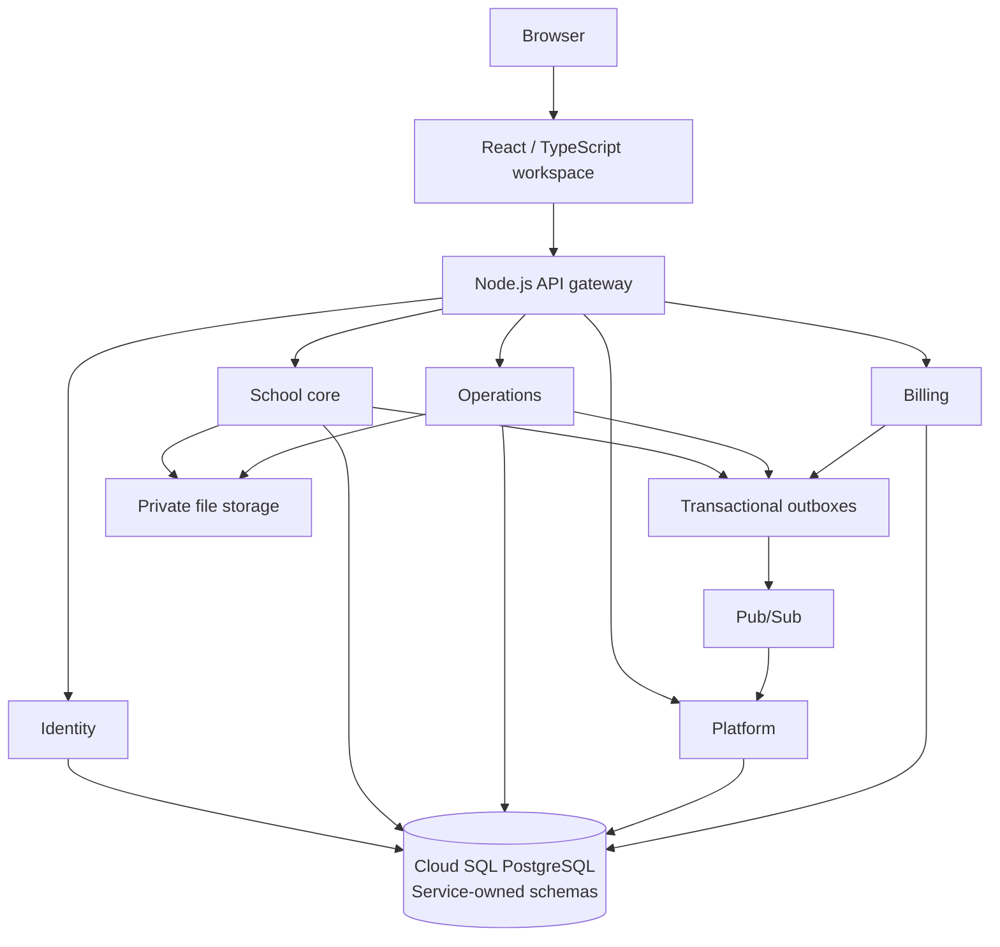

# Project Architecture

Source reconciled: 2026-10-12 against the current repository implementation.

This document describes source boundaries and deployment behavior. Runtime evidence has its own
capture date and environment; development implementation does not establish production acceptance.
Use [the owner-action plan](../security-remediation/acceptance-owner-actions.md) for outstanding
security and operational acceptance, and fresh runtime inventory for current deployed configuration.

## System shape and rationale

Custoking IMS is a multi-tenant school operations, procurement, and billing platform in a monorepo.
Its main application topology is seven deployable applications: a React frontend, a Node HTTP
gateway, and five Java domain services. Twelve logical domains are grouped into those five Java
processes; the gateway's twelve diagnostic aliases are compatibility routes, not twelve Java services.

School core groups closely related school transactions in one process. Identity owns authentication
and authoritative sessions. Operations and billing have distinct workflow and financial responsibilities.
Platform maintains event-fed reporting and notification state so dashboards can read their own models.
These boundaries reduce distributed transactions while allowing domain services to be deployed separately.

## Applications and ownership

| Application | Main responsibility | Owned schemas |
| --- | --- | --- |
| Frontend | nginx-served React workspace, role/module navigation, forms and generated API clients | None |
| API gateway | Ordered routing, authoritative user authentication, trusted context, quotas, bounded proxying and Cloud Run upstream identity | None |
| Identity service | Login, refresh/logout, password recovery, MFA/passkeys, users, RBAC and school/zone/operator assignments | `identity` |
| School-core service | Schools, zones, classes, staff, timetable, students, guardians, consent, imports, photos, attendance, school fees, catalog orders and annual plans | `tenant_school`, `student`, `attendance`, `fee`, `catalog` |
| Operations service | Versioned workflow decisions, urgent procurement, quotations and documents | `workflow`, `firefighting` |
| Platform service | Reporting projections, dashboards, command center, notifications, broadcasts, provider outcomes and audit | `reporting`, `notification`, `audit` |
| Billing service | Platform/customer invoices, billing payments, invoice sequences and billing events | `billing` |

School fee collection belongs to school core; business/platform invoice payment belongs to billing.
The optional operator dashboard in `tools/live-dashboard` is separate from these seven applications.
Its OAuth allowlist and shared Firestore security state have their own deployment and acceptance path.

## Repository and build boundaries

- Root `pom.xml` is the Maven parent and five-service reactor: Spring Boot 4.1.1 and Java 25.
- Java images build with the repository root as context and copy the parent plus the selected service.
- Frontend declares React 18, TypeScript, Vite 6 and React Router 7; Node 24/npm 11 are required.
- The gateway uses CommonJS and native Node HTTP/fetch.
- Typical Java packages are `api`, `application`, `persistence`, `infrastructure`, `security`,
  `observability` and, for event producers, `outbox`.
- Some controllers call repositories directly, and some repositories also orchestrate transactions
  and business validation. Package names do not imply a uniformly strict application-service layer.
- Canonical and compatibility student controllers route their repository write operations through
  `application/StudentCommands`. Its 19 command entry points own transactions; managed persistence
  writes require an existing transaction and cannot start one.
  Directory/workspace list reads live in `persistence/StudentDirectoryQueries`; detail, history,
  fee history and stored-photo reads live in `StudentProfileQueries`.
  Imports, promotions and reviews have separate persistence components. They participate in the
  application transaction and retain mandatory guards on their managed write entry points.
  Shared structure/calendar access and enrollment/outbox writes each have one implementation.
  Admission/update and erasure remain cohesive orchestrations in the facade, using those shared
  components. Existing manual fixture/recovery constructors and public response records remain compatible.
- Ten intentionally identical infrastructure classes are guarded by
  `scripts/check-duplicate-class-drift.py`. Service-specific variants remain independent.

## Data and tenant boundaries

Cloud SQL PostgreSQL infrastructure is shared within each environment. Services own schemas rather
than separate database instances. Shared database availability, backup/recovery and connection capacity
therefore remain common operational concerns.

[The schema-dependency baseline](../RUNTIME_SCHEMA_DEPENDENCY_BASELINE.json) assigns twelve schemas
and currently has an empty `allowedExternalSchemas` map. Runtime cross-service SQL must not be added;
read models consume events and request/response integrations use service APIs. The source audit detects
known schema references; it does not prove arbitrary dynamically constructed SQL.

Dedicated runtime roles are selected by deployment configuration:

| Service | Dedicated role |
| --- | --- |
| Identity | `ims_identity_rt` |
| School core | `ims_school_core_rt` |
| Operations | `ims_operations_rt` |
| Platform | `ims_platform_rt` |
| Billing | `ims_billing_rt` |

Local configuration retains an `app_rt` fallback. `RuntimeDbRoleGuard` verifies the configured role,
effective privileges, memberships, ownership and required RLS policies. Migration privileges belong to
a separate migration entry point/job; normal deployed application startup does not run Flyway.

Application permission/module checks and `TenantScope` establish school, zone and assigned-operator
boundaries. `TenantAwareDataSource` applies PostgreSQL context on each borrowed connection:

- `app.current_school_id`
- `app.current_zone_id`
- `app.operator_schools`
- `app.bypass_rls`

Context is reset before pooled connections return, with contaminated connections discarded on reset
failure. Tenant-scoped tables use PostgreSQL row-level security; startup guards check required FORCE
RLS and policies. System inbox/control tables have deliberately different context requirements.

## Browser request and authentication flow

1. The central frontend Axios transport sends a request to the gateway.
2. `routing.js` selects the first matching route, including HTTP-method restrictions and alias rewriting.
3. Rewritten `/api/v1/internal/**` and `/api/v1/pubsub/**` requests are blocked before user authentication.
4. Protected requests call identity introspection for persisted session state and current permissions
   and assignments. Optional local JWT verification is an additional rejection prefilter.
5. The gateway strips untrusted principal/service headers and stamps authoritative user, session,
   permission and tenant context. It injects the target logical service credential and Cloud Run ID token.
6. The service enforces its authorization boundary, application scope and database policies.

Identity introspection remains authoritative for every protected request. This supports revocation
without trusting stale embedded JWT permissions, while adding an identity HTTP/database dependency.
Unavailable identity responses fail closed; they are not treated as proof that a password expired.

Public auth routes are explicit. The exact MSG91 email callback is also public to user authentication,
but the platform controller requires the gateway service credential and a separate callback credential.
Compatibility aliases and callback siblings do not inherit that exemption.

## Gateway modules and API contracts

- `services/api-gateway/routing.js`: ordered route declarations, prefix/regex/method matching,
  diagnostic rewriting and internal-path classification; no HTTP server or environment dependencies.
- `services/api-gateway/server.js`: environment configuration, module composition, ordered HTTP request
  handling, security headers/CORS and structured request/tracing lifecycle.
- `services/api-gateway/authentication.js`: explicit-dependency factory for authoritative identity
  introspection, optional rejecting JWT prefilter, public/cookie route policy and step-up policy.
- `services/api-gateway/quota.js`: per-instance bounded rate buckets and verified-user budget grouping;
  associations never authenticate a request or suppress identity introspection.
- `services/api-gateway/transport.js`: explicit-dependency factory for service credentials, Cloud Run
  authorization, principal/header propagation, safe targets, streaming bounds/backpressure and deadlines.
  Its injectable fetch transport permits isolated tests without starting the HTTP server or reading secrets.
- `services/api-gateway/api-contract.js`: compatibility classification and deprecation headers.
- `services/api-gateway/tracing.js`: tracing/export lifecycle.
- `scripts/generate-api-route-inventory.js`: controller method/path inventory and gateway route metadata.

The current inventory records 49 controllers and 449 method/path mappings: 345 canonical,
90 compatibility and 14 internal, plus 70 gateway entries and 12 diagnostic aliases.
Mapping totals include compatibility surfaces and are not business-feature counts.
Only Spring path/value attributes define URLs; consumes/produces/header metadata does not.

OpenAPI covers 83 critical canonical operations across 11 contracts/clients. This is partial payload
coverage, not the complete 449-mapping inventory. Clients share Axios authentication, preserve stable
idempotency keys and reviewed versions/fingerprints, and support multipart uploads and Blob downloads.
[Browser contract details](../../contracts/openapi/README.md) and
[the current API contract overview](api-contracts.md) describe the supported generator subset.

Inventory freshness and generated-client freshness are checked in PR and release gates. Contract
tests also resolve typed operations through the actual runtime route table, preserving route precedence.

## Asynchronous work

School core, operations and billing write an outbox row in the same SQL transaction as the domain
change. Relays publish before marking the row complete, so delivery is at least once. Duplicate delivery
is expected after uncertain outcomes and consumers must be idempotent.

Pub/Sub push reaches private platform ingress. Durable inboxes retain event state; leased workers
project reporting dimensions/facts and process notification work with retries and failure records.
Reporting repositories read owned projections rather than joining domain schemas. Dashboards are
eventually consistent and can lag a successful domain write.

`ReportingReadRepository` retains its API and response records as a facade. Invoice, photography,
attendance, fee, procurement, workspace and command-center query groups have separate components.
`ReportingSchoolContext` centralizes calendar/localization reads, `ReportingScalarQueries` centralizes
scalar SQL reads and `ReportingPresentation` owns pure formatting. These components use platform-owned
schemas and retain the existing school filters, SQL, status handling, pagination and calculations.
Explicit constructor dependencies avoid query groups calling back through the facade; a managed
Spring wiring test verifies this graph. This changes source ownership without introducing another
runtime service, database connection pool or cross-service query.

Private Google-OIDC-authenticated Scheduler calls wake relay/drain endpoints. In-process scheduled
loops alone do not guarantee progress on scale-to-zero Cloud Run instances.
See [the event contract](../EVENT-ENVELOPE-CONTRACT.md) and
[internal authorization](../INTERNAL-SERVICE-AUTHORIZATION.md).

## Frontend, catalog and files

Top-level app routes and workspace panels are lazy-loaded. Role/permission/module checks select
navigation; workspace state tracks drafts and unsaved edits. Access JWTs live in module memory.
The central API transport coordinates refresh and logout across concurrent requests and browser tabs.

`useWorkspaceNavigation` owns panel URLs, role/permission/module filtering, bookmark fallback and
urgent-request draft links. `useWorkspaceDrawer` owns responsive modal behavior, focus trapping,
focus restoration and sidebar preferences. `useSupplyOrders` retains order loading, approval/rejection,
design confirmation and reorder state across navigation; `SupplyOrdersPanels` wires order panels.
`useWorkspaceBootstrap` loads the school workspace and entitlements together, preserves pending
entitlements after partial failure, and owns retry/authentication recovery and role-specific shells.
School, platform and firefighting containers in `WorkspacePanels` select the other lazy panels.
These containers own no drafts or command state. `WorkspaceDraftProvider` remains scoped to the current
user/school/zone and keeps unsaved data in memory across panel navigation. Moving those responsibilities
out of `UnifiedWorkspacePage` does not turn browser navigation checks into server authorization.

Catalog categories and form definitions drive dynamic forms, alongside older handwritten category
forms. Trophies use the existing catalog category/order domain, with reference data and image assets
under `frontend/src/features/catalog/trophies`; no additional runtime service is required.

Student photos/imports/exports and quotation documents use private storage integrations. Student
erasure uses a precommit intent journal, lineage fences, durable photo cleanup and retained receipts.
Recovery tools have separate privileges and execution controls; their existence does not establish a
completed full restore rehearsal.

## Deployment and operational evidence

Cloud Run targets use region `asia-south2`. Branch `dev` targets `custoking-dev`; branch `main`
targets `custoking-prod`. Production promotes approved, signed dev image digests rather than
rebuilding the same source independently. Changed-service dev releases and configuration/production
canary paths are defined by `.github/workflows/build-release.yml`.

Secret Manager supplies credentials. IAM, pooled PostgreSQL connections, structured logs,
OpenTelemetry traces and Cloud Monitoring support the runtime. Capacity must coordinate Cloud Run
instance/concurrency limits with per-service connection pools.

The source architecture, a successful dev release and operational acceptance are separate evidence.
Outstanding provider, edge, recovery, hardware and other owner gates remain in
[the owner-action plan](../security-remediation/acceptance-owner-actions.md).

## Guardrails for further maintenance

| Area | Boundary implemented | Continuation scope |
| --- | --- | --- |
| Student repositories | Command transactions and mandatory guards; directory/profile reads; import/promotion/review groups; shared structure/enrollment persistence and pure parsing/formatting | Planned responsibility groups completed; admission/update and erasure retain their atomic orchestration |
| Reporting repository | Seven query groups, shared context/scalar reads and formatting behind the existing facade | Planned query groups completed |
| Workspace UI | Navigation, drawer, bootstrap and supply-order hooks; school/platform/firefighting/order containers; scoped draft provider | Planned loading and panel groups completed |
| Gateway server | Ordered routing and separate injectable authentication, quota and proxy transport factories | Planned module boundaries completed |
| Browser contracts | 83 canonical operations across 11 clients, including reporting drilldowns and student lifecycle server/client checks | Broader payload coverage remains incremental; the 449-mapping inventory is not full payload coverage |

Each refactor must preserve authorization, tenant scope, transaction atomicity, idempotency, uncertain
outcome handling and unsaved-edit behavior. Applied migrations and dated acceptance evidence retain
their recorded meaning.

Student command extraction retains the 45-second erasure/reconciliation timeout and the existing
transaction propagation and rollback behavior. External precommit erasure intents still precede
mutation and survive rollback; import progress still completes after commit. Offline recovery keeps
its separately bounded `TransactionTemplate`. New PostgreSQL integration cases verify admission
and update rollback when an outbox write fails, and reject managed writes outside a transaction.

Local verification is recorded with the maintenance commit and source-bound closeout evidence in
`tmp`. The current phase adds isolated gateway factory checks, managed student/reporting wiring and
transaction guards, bootstrap/recovery tests and serialized reporting response/tenant-denial checks.
Method comparisons preserve 37 gateway functions, 33 reporting methods, 10 student profile methods,
105 grouped student methods and the 19 command implementations, allowing only explicit component
qualification and fetch injection. SQL literals and the erasure workflow retain their previous meaning.

Final local checks: 450 frontend tests, 506 platform tests and the 990-test school-core suite have
zero failures/errors. School core has one Windows symlink-privilege skip; all eight asset-security
tests pass separately in Linux with no skips, including that symlink case. The gateway suite passes
108 tests, the additional generator suite passes eight tests, and the machine-authorization audit
regressions pass 16 tests. Twelve architecture audits, inventory/client freshness, ten guarded-class
comparisons, the frontend and Java builds, and eight non-root gateway-image HTTP smoke checks pass.

The planned responsibility refactors and their scoped dev delivery are accepted in
[the release closeout and remaining fix plan](architecture-maintenance-release-2026-10-12.md).
That acceptance includes exact-image/runtime binding, Linux/browser tests and bounded public checks.
The operational owner gates and incremental payload coverage remain open; production was not changed.
